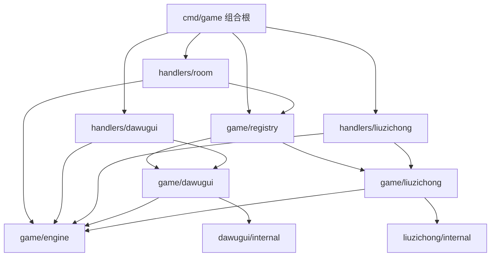

# ADR-002：可插拔游戏架构约束

| 项 | 值 |
| :--- | :--- |
| **Status** | Accepted |
| **Date** | 2026-07 |
| **Updated** | 2026-11 |
| **Depends on** | ADR-001, ADR-004, ADR-005 |

---

## 背景

平台需支持多游戏（dawugui 及后续），增游戏时 **不改** wallet、room 核心、OpenAPI 公共 schema、签名/JWT 中间件。多游戏仍跑在**同一** `cmd/game` 进程；边界靠包结构 + lint 强制，便于专人维护各游戏。

---

## 包依赖规则

| 规则 | 说明 |
| :--- | :--- |
| `internal/platform/*`、`pkg/*` | **禁止** import `internal/game/{具体游戏}` |
| `internal/game/{id}/` | **禁止** import Pitaya / Gin；**禁止** import 其他 `{id}` |
| `internal/game/{id}/internal/` | 仅本游戏可引用；对外只经公共面（`GameID` / `New` / `NewBotPicker`） |
| `internal/game/engine` | 仅 interface 与类型（含 `BotPicker`、`TurnAware`），无 IO |
| `handlers/room`、`pitaya/bot` | 只许 `engine` + `game.Get`/`game.Bot`；禁止具体游戏包 |
| `handlers/{id}` | 只许本游戏公共面 + engine；禁止跨游戏 handler/engine |
| 组合根白名单 | 仅 `cmd/game`、`internal/game`（registry）可同时依赖多个具体游戏 |
| `cmd/game-api` | **禁止** import pitaya handlers |

强制手段：`go run ./cmd/check-boundaries`（`make lint`）+ 可选 `server/.golangci.yml` depguard。

---

## 增游戏白名单

| 允许改动 | 路径 |
| :--- | :--- |
| 规则引擎 | `internal/game/{gameId}/`（公共 factory）+ `internal/game/{gameId}/internal/` |
| Bot 策略 | 同游戏包内 `NewBotPicker`（实现 `engine.BotPicker`） |
| Pitaya Handler | `internal/pitaya/handlers/{gameId}/` |
| 注册 | `internal/game/registry.go`（`Get` + `Bot`）+ `cmd/game` Register |
| Proto | `proto/pitaya/{gameId}.proto` |
| 运营配置 | `docs/games/{gameId}/ops-hooks.md` → PG JSONB |
| 文档 | games/README、运营手册 |

| 禁止改动 | 说明 |
| :--- | :--- |
| `internal/platform/wallet` | 房卡/游戏币逻辑 |
| `openapi/components/` 公共 schema | 除新增游戏 config 字段外 |
| `openapi/http-signature.md` | 签名算法 |
| `internal/pitaya/handlers/connector` | 除非平台级变更 |
| `internal/pitaya/handlers/room` | **默认禁止**；变更须 [room-change-checklist](../room-change-checklist.md) + platform owner（CODEOWNERS）批准 |
| `internal/game/engine` | 接口变更须修订本 ADR |

---

## Proto / Route 规范

### Route 命名

格式：`{serverType}.{handler}.{method}`，MVP `serverType=game`。

| 域 | Handler | 示例 |
| :--- | :--- | :--- |
| 连接 | connector | `game.connector.entry` |
| 房间 | room | `game.room.join` |
| 游戏 | {gameId} | `game.dawugui.playcards` |

### Push Route（服务端→客户端）

| Push | Route |
| :--- | :--- |
| 房间状态 | `onRoomState` |
| 发牌 | `onDeal` |
| 轮次 | `onTurnNotify` |
| 报单 | `onAlert` |
| 结算 | `onSettlement` |
| 错误 | `onError` |

### Proto 文件编号段

| 文件 | 包 | 用途 |
| :--- | :--- | :--- |
| `proto/pitaya/common.proto` | pitaya.common | EventMeta、PushHeader |
| `proto/pitaya/event.proto` | pitaya.event | GameEvent oneof（落库） |
| `proto/pitaya/connector.proto` | pitaya.connector | entry/bind |
| `proto/pitaya/room.proto` | pitaya.room | join/ready/leave/sync |
| `proto/pitaya/dawugui.proto` | pitaya.dawugui | 打乌龟 req/rsp/push |

新游戏新增 `proto/pitaya/{gameId}.proto`，**不修改**已有 message 字段编号；GameEvent 扩展见 ADR-005。

### EventMeta / audit_sn

- 所有 **Push** 必含 `PushHeader.meta`（`audit_sn` + `action_seq`）
- 与 `game_action_log` 一 event 一 log
- Request Response 可选 `EventMeta`（playcards/pass）

---

## GameEngine 接口稳定性

- `internal/game/engine` 接口变更需 ADR 修订
- Bot 与平台协作：`BotPicker` + `TurnAware`；禁止 platform 依赖具体 `State`
- 新增能力优先用**可选接口**（type assert）或结构体加字段，避免破坏现有实现

### 必选

| 契约 | 说明 |
| :--- | :--- |
| `GameEngine` | Meta / NewState / ApplyAction / OnTick / VisibleState / CheckRoundEnd / CalcSettlement |
| `GameState` | GameID / Clone |
| `Action` | Kind=Play\|Pass\|Move；可选 `Opcode`+`Payload` 表达叫分/吃碰等 |
| `GameConfig.Seed` | 0=未指定；游戏可按需用于可复现 RNG |
| `SettlementResult` | WinnerID 捷径；`Draw` + `PlayerScore.Rank`/`TeamID` 按需 |

### 可选（游戏按需实现；平台未检测到则跳过）

| 接口 | 用途 |
| :--- | :--- |
| `TurnAware` | bot/托管代打读当前座位 |
| `BotPicker` | bot/托管出招（无则托管不代打、不崩溃） |
| `Phased` | `Phase()` 多阶段；Join/Sync 可带回 `game_phase` |
| `Snapshotter` | 重连快照 Push（补强 action-log Sync） |
| `SpectatorViewer` | 旁观全可见视图（未实现则仅收公开广播） |

### 平台 room 钩子（非 Engine 方法）

| 能力 | 行为 |
| :--- | :--- |
| 旁观 | `JoinReq.as_spectator`；`SeatRoleSpectator`；不计 PlayerCount |
| 托管 | `game.room.trusteeship`；重连清除；有 BotPicker 才代打 |
| 重连 | 同 user 再 Join → `rejoined` + Online；Session OnClose → Online=false；Sync 补 Push |

---

## 成长期演进（文档预留）

| 阶段 | 变更 |
| :--- | :--- |
| Cluster | `connector` Frontend + `game` Backend；`AddRoute(room_id)` |
| 平台 Remote | Wallet 抽为 `platform` serverType，User RPC |
| 热更新配置 | watch PG `game_config`，Engine 版本灰度 |

---

## 相关文档

| 文档 | 内容 |
| :--- | :--- |
| [004-pitaya-game-framework.md](004-pitaya-game-framework.md) | Handler/Engine 分工 |
| [room-change-checklist.md](../room-change-checklist.md) | 公共 room 变更影响评估 |
| [proto/pitaya/README.md](../proto/pitaya/README.md) | Route proto |
| [005-ordered-action-log-replay.md](005-ordered-action-log-replay.md) | 有序日志 |
| [audit-action-log.md](../audit-action-log.md) | DDL |
