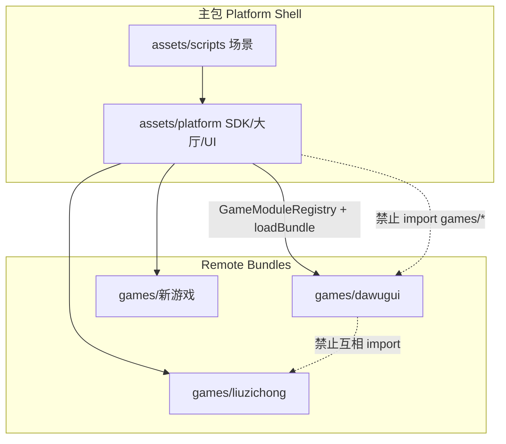

# 客户端目录结构与开发约束

> Cocos Creator **3.8.8** 工程根目录：`client/`。  
> 架构分层见 [client-architecture.md](client-architecture.md)；协议见 [pitaya-client.md](pitaya-client.md)；UI 见 [cocos-ui.mdc](../../.cursor/rules/cocos-ui.mdc) / [cocos-ui-llm-prompt.md](cocos-ui-llm-prompt.md)。

---

## 1. 工程总览

```
client/
├── assets/                 # ★ 业务资源与脚本（版本控制主体）
│   ├── platform/           # 平台主包（登录/大厅/SDK，随壳包发布）
│   ├── scripts/            # 平台场景脚本与 Session
│   └── games/              # 各游戏 Remote Bundle（按需下载）
├── scripts/                # Node 工具（proto 补丁、脚手架、边界检查）
├── tests/                  # Vitest（不依赖编辑器）
├── settings/               # Creator 工程设置（设计分辨率等）
├── profiles/               # 编辑器个人配置（可提交部分）
├── .creator/               # Creator 工程元数据
├── import-map.json         # npm 模块映射（bufbuild 等）
├── package.json            # creator.version 锁定 3.8.8；npm test
├── tsconfig.json           # 编辑器 / 工程 TS
├── tsconfig.vitest.json    # 单测 TS
├── vitest.config.mts
├── README.md               # 本地打开与联调速查
├── build/                  # 构建产物（一般不入库或仅 stub）
├── library/                # Creator 缓存（勿手改、勿当源码）
├── temp/                   # 预览临时文件（勿手改）
└── node_modules/           # npm 依赖
```

| 目录 | 放什么 | 约束 |
| :--- | :--- | :--- |
| `assets/` | 场景、脚本、图音、Bundle | **唯一**业务源码树 |
| `scripts/` | 仓库级 Node 脚本 | 不放游戏逻辑 |
| `tests/` | Vitest | 不依赖 `cc` 运行时的纯逻辑 |
| `settings/` | 设计分辨率、构建配置 | 改分辨率须对齐 UI 规范 |
| `library/` / `temp/` / `build/` | 缓存与产物 | **禁止**当源码编辑；勿提交大缓存 |

---

## 2. `assets/` 三层模型



| 层 | 路径 | 职责 |
| :--- | :--- | :--- |
| **场景壳** | `assets/scripts/` | Launch / Lobby / Room / Profile 场景与入口组件 |
| **平台** | `assets/platform/` | HTTP/WS SDK、大厅、伴侣、生成代码、平台 UI |
| **游戏** | `assets/games/{gameId}/` | 单游戏 Bundle：Module、PushHandler、场景、美术 |

---

## 3. 目录明细

### 3.1 `assets/scripts/`

| 路径 | 内容 |
| :--- | :--- |
| `scenes/Launch.scene` + `LaunchScene.ts` | 登录起始场景 |
| `scenes/Lobby.scene` + `LobbyScene.ts` | 大厅（游戏架 / 伴侣 / 我的覆盖层） |
| `scenes/Room.scene` + `RoomScene.ts` | 进房壳；经 Registry 调游戏，**不为新游戏硬改** |
| `scenes/ProfileScene.ts` | 可选独立「我的」场景 |
| `scenes/images/` | 平台场景专用图 |
| `SessionStore.ts` | access/refresh 等本地会话 |

**约束**

- 场景脚本可依赖 `platform/*`；**禁止**直接 `import` 某个 `games/{id}` 实现细节（进游戏走 Registry + Bundle）。
- 新游戏入口通过大厅 API + Bundle，不在 Lobby 写死按钮列表（见 ADR-006）。

### 3.2 `assets/platform/`

| 路径 | 内容 | 谁可改 |
| :--- | :--- | :--- |
| `sdk/` | `ApiClient`、`PitayaClient`、`GameSession`、`signature`、`EventTracker`、`PushRouter`、`ReplayPlayer`、`config` | 平台；协议变更需同步文档 |
| `lobby/` | `GameModuleRegistry`、`GameBundleManager`、`GameShelf`、AutoBuilder、UIKit、Profile | 平台 |
| `companion/` | 智能伴侣面板 / SSE / 侧栏钩子 | 平台；游戏只通过 `companionHooks` |
| `host/` | `GameHost`、Launch AutoBuilder | 平台（大厅 / 独立 App 双入口） |
| `ui/` | 平台壳 UI 资源：`common/`、`lobby/icons/` | 平台美术 |
| `generated/pitaya/` | **生成** TS proto | **禁止手改**；`make gen-client-proto` |
| `vendor/` |  vendored 依赖（如 bufbuild wire） | 仅工具脚本更新 |

**`sdk/config.ts` 构建注入**

| 全局常量 | 默认（未注入） |
| :--- | :--- |
| `GAME_API_BASE` | `http://localhost:8080` |
| `GAME_AUTH_BASE` | `http://localhost:8081` |
| `GAME_APP_ID` | `cocos-dev` |
| `GAME_HMAC_SECRET` | `dev-hmac-secret-change-me` |

须与服务端 `APP_ID` / `HMAC_SECRET` 一致。注入方式见 [client/README.md](../../client/README.md)「配置」。

### 3.3 `assets/games/{gameId}/`

每个游戏一个 **Remote Bundle** 根目录（编辑器中勾选 Bundle）。

| 路径 | 内容 |
| :--- | :--- |
| `{GameId}Module.ts` | 实现 `GameModule`，注册 push / 场景 / companionHooks |
| `GameEntry.ts` | Bundle 加载入口（注册 Module） |
| `{GameId}PushHandler.ts` | 服务端 Push → UI（与 live/replay 共用） |
| `*Scene.ts` / `*.scene` | 游戏内场景（如棋盘） |
| `images/` | 图标、封面、小图 |
| `textures/` | 牌面、棋盘、背景 |
| `ui/` | 局内按钮、面板 |
| `audio/` | 音效（可选） |
| `_template/` | 新游戏脚手架（复制后改名） |

初始化空目录：`cd client && npm run scaffold:assets`。

**约束**

- 游戏 A **禁止** import 游戏 B。
- 游戏可依赖 `platform/sdk`、`platform/lobby` 的 **公开类型/API**；禁止改平台去适配单一游戏特例（应在 Module 钩子内消化）。
- **禁止**在客户端实现权威规则（胜负、出牌合法性以服务端 Push / 拒绝码为准）。
- Bundle 名与 `game_id`、库表 `game_client_bundle` 一致。

### 3.4 `client/scripts/`（Node）

| 脚本 | 作用 |
| :--- | :--- |
| `check-imports.mjs` | 相对路径可解析 + **目录边界**（`npm test`） |
| `scaffold-asset-dirs.mjs` | 补全资源子目录与 `.meta` |
| `patch-proto-long.mjs` | gen-client-proto 后补丁 |
| `sync-bufbuild-wire.mjs` | 同步 vendor wire |

### 3.5 勿当业务源码

| 路径 | 说明 |
| :--- | :--- |
| `library/` | AssetDB 导入缓存 |
| `temp/` | 预览 / packer 临时 |
| `build/` | Web/原生构建输出；`sync-bundles` 可读 `build/web-desktop/remote` |
| `node_modules/` | npm |
| `*.meta` | Creator 资源 UUID；改名/移动用编辑器，避免 UUID 断裂 |

---

## 4. 开发约束（硬规则）

违反即审查打回；`npm test`（含 `check-imports`）应失败。

### 4.1 依赖方向

```
scripts/scenes  →  platform/*
games/{id}      →  platform/*（公开 API）
platform/*      →  禁止 → games/*
games/{a}       →  禁止 → games/{b}
generated/      →  禁止手改
```

**唯一例外**：`platform/lobby/GameBundleManager.ts` 可对 `games/{id}/*Module` 做 **dynamic `import()`**，用于预览/本地 Bundle 的 Module 注册兜底（ADR-006）。禁止在其他 platform 文件静态或动态依赖游戏包。

### 4.2 协议与网络

| 允许 | 禁止 |
| :--- | :--- |
| HTTP：`ApiClient` + OpenAPI 路径 | 手写未签名裸 `fetch` 调 `/v1`（除非健康检查） |
| WS：`PitayaClient` + 生成 proto | 自造与服务端不一致的报文 |
| 断线：`EventTracker` + `game.room.sync` | 静默丢 seq 或本地假推进 |
| Push 驱动 UI | 客户端本地算胜负/结算后改展示权威 |

### 4.3 大厅与 Bundle

| 允许 | 禁止 |
| :--- | :--- |
| `GameBundleManager.ensureLoaded` | Lobby 硬编码每个游戏按钮 |
| `GameModuleRegistry.register` | `RoomScene` 为新游戏写死 `if (gameId===...)` |
| 预览态加载本地 Bundle | 预览依赖跨域 `:8787` 远程脚本当唯一路径 |

### 4.4 UI（摘要）

- 设计分辨率 **720×1280**，**FIXED_HEIGHT**；详见 `.cursor/rules/cocos-ui.mdc`。
- UI 挂 **Canvas / UI_2D**；颜色跟 `LobbyTheme`，勿另起默认皮肤。
- 省图：禁止默认整屏超大图。

### 4.5 文案与货币

- 简体中文；房卡 ≠ 游戏币（龟币/冲币等），勿混称。

### 4.6 密钥

- 客户端 `GAME_HMAC_SECRET` 会出现在包内，**不能当机密**；生产轮换 + 网关/风控。
- 与 `auth-service` / `game-api` / `admin` 的 `HMAC_SECRET`、`APP_ID` 必须一致。

---

## 5. 常见任务落点

| 需求 | 改哪里 |
| :--- | :--- |
| 登录 / 刷新 / HMAC | `platform/sdk/ApiClient.ts`、`signature.ts`、`config.ts`；场景 `LaunchScene` |
| 进房闭环 | `sdk/GameSession.ts`；`RoomScene` |
| 大厅列表 / 货架 | `platform/lobby/*`；`LobbyScene` |
| 伴侣 | `platform/companion/*` |
| 新游戏 | 复制 `games/_template/` → `games/{id}/`；Module + PushHandler + Bundle；服务端见 [new-game-guide.md](new-game-guide.md) |
| 新 Push 字段 | 先改 `server/proto` → `make gen-client-proto` → PushHandler |
| 回放 | `sdk/ReplayPlayer.ts` + 复用 PushHandler |
| 资源目录补齐 | `npm run scaffold:assets` |

---

## 6. 检查清单（提交前）

- [ ] `cd client && npm test`（Vitest + import/边界检查）
- [ ] 未手改 `platform/generated/`
- [ ] 无跨游戏 / platform→games 依赖
- [ ] 新游戏已 `GameModuleRegistry` 注册，且未改死 `RoomScene` 分支
- [ ] UI 符合 720×1280 / FIXED_HEIGHT / UI_2D
- [ ] 联调：`run-auth` + `run-game-api` + `run-game`；CORS 含预览源

---

## 7. 相关文档

| 文档 | 内容 |
| :--- | :--- |
| [client/README.md](../../client/README.md) | 打开工程、场景挂载、Bundle 联调 |
| [client-architecture.md](client-architecture.md) | 双通道分层与场景流 |
| [pitaya-client.md](pitaya-client.md) | Pitaya 报文与 sync |
| [new-game-guide.md](new-game-guide.md) | 全栈新游戏 |
| [adr/006](adr/006-game-lobby-dynamic-bundle.md) | 动态 Bundle |
| [adr/008](adr/008-game-host-sdk.md) | GameHost |
| [cocos-ui-llm-prompt.md](cocos-ui-llm-prompt.md) | UI 生成提示词 |
