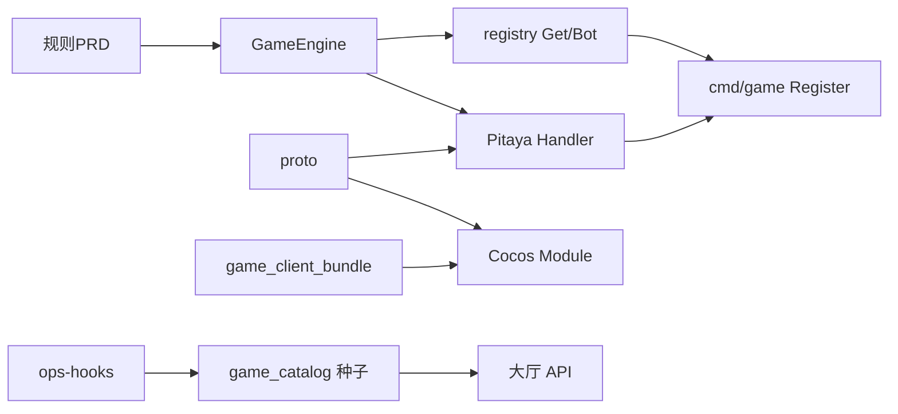

# 如何添加新游戏（开发指南）

> 适用：服务端 + 客户端技术接入。运营文档见 [docs/games/README.md](../games/README.md)。  
> 约束真源：[ADR-002](adr/002-pluggable-game-constraints.md)。  
> 参考实现：`dawugui`（扑克类）、`liuzichong`（棋类）。

**运行方式**：新游戏挂到**同一个** `cmd/game`（WS `:3250`），不另起进程。专人维护靠包边界 + lint，不是按游戏拆服务。

---

## 0. 总览



| 层 | 你要做的 | 禁止做的 |
| :--- | :--- | :--- |
| 规则 | `internal/game/{id}/` + `internal/` | import 其他游戏、Pitaya、Gin |
| 协议 | `proto/pitaya/{id}.proto` | 改已有 message 字段编号 |
| IO | `handlers/{id}/` | 改 `handlers/room`（默认） |
| 装配 | `registry.go` + `cmd/game` | 在 platform/pkg 里 import 具体游戏 |
| 客户端 | `client/assets/games/{id}/` | 在 Lobby 硬编码按钮 |
| 数据 | migration 种子 catalog/bundle | 改 wallet 核心逻辑 |

完成后执行：`make lint`（边界）+ `make test` + 联调 P0 流程。

---

## 1. 命名与目录

假设新游戏 ID 为 `foo`（小写、与 `game_id` 一致）：

```
server/internal/game/foo/
  doc.go                 # 公共面说明
  factory.go             # GameID, New(), NewBotPicker()
  internal/rules/        # State、Engine、Bot、单测（仅本包可引用）
server/internal/pitaya/handlers/foo/handler.go
server/proto/pitaya/foo.proto
docs/games/foo/ops-hooks.md
client/assets/games/foo/   # Cocos Remote Bundle
```

公共面**只允许**导出：`GameID`、`New() engine.GameEngine`、`NewBotPicker() engine.BotPicker`。  
`State` 等实现细节放在 `internal/rules`，禁止其他游戏/platform 直接依赖。

---

## 2. 服务端步骤

### 2.1 实现 GameEngine

在 `internal/game/foo/internal/rules` 实现 [`engine.GameEngine`](../../server/internal/game/engine/engine.go)：

| 方法 | 职责 |
| :--- | :--- |
| `Meta` | min/max 人数、`GameID` |
| `NewState` | 开局状态 + 初始 `[]GameEvent`（发牌/棋盘等） |
| `ApplyAction` | 出牌/落子等；返回新状态 + 事件 |
| `OnTick` | 超时（可选） |
| `VisibleState` | 某座位可见信息 |
| `CheckRoundEnd` / `CalcSettlement` | 终局与结算 |

状态需实现：

- `engine.GameState`（`GameID` / `Clone`）
- `engine.TurnAware`（`TurnSeat` / `IsPlaying`）——供通用 bot 调度

公共 `factory.go` 示例：

```go
package foo

import (
  "github.com/example/game/internal/game/engine"
  "github.com/example/game/internal/game/foo/internal/rules"
)

const GameID = rules.GameID

func New() engine.GameEngine { return rules.New() }
func NewBotPicker() engine.BotPicker { return rules.NewBotPicker() }
```

### 2.2 可选能力（按需实现）

| 能力 | 如何实现 | 不实现时 |
| :--- | :--- | :--- |
| Bot / 托管代打 | `BotPicker` + 状态实现 `TurnAware` | 托管开关可用，但不自动出牌 |
| 多阶段 | `GameState` 实现 `Phased` | Join/Sync 的 `game_phase` 为空 |
| 重连快照 | `GameEngine` 实现 `Snapshotter` | 仅靠 `room.sync` action-log |
| 旁观透视 | `SpectatorViewer` | 旁观者只收公开 Push |
| 可复现 | `NewState` 使用 `GameConfig.Seed` | Seed=0 时用时间熵即可 |
| 复杂招法 | `Action.Opcode` + `Payload` | 继续用 Play/Pass/Move |
| 名次/阵营结算 | 填 `PlayerScore.Rank` / `TeamID`、`Draw` | 只填 WinnerID + RuleScore |

`BotPicker` 示例：

- `Pick(state, seat) (Action, bool)`
- `ActionRoute(action) string` → 如 `game.foo.move`
- `SettlementRoute() string` → `game.foo.settlement`

平台侧统一 `bot.RunPending`（含托管座位）；**不要**再写 `RunFooBots`。

### 2.3 注册组合根

1. [`registry.go`](../../server/internal/game/registry.go)：`Get` / `Bot` 增加 `case foo.GameID`
2. [`cmd/game/main.go`](../../server/cmd/game/main.go)：`pitaya.Register(fooh.New(...), WithName("foo"), ...)`

仅这两处 + handler 允许「看到」多个具体游戏。

### 2.4 Pitaya Handler

`handlers/foo/handler.go`：

- 解析 Session → 取房间 → `store` 中的 `EngineState`
- 调 `ApplyAction` → `committer.CommitEventsLocked`（落库 + Push）
- Push 必须带 `audit_sn` + `action_seq`（ADR-005）
- 可调用 `bot.RunPending`；**禁止** import `liuzichong` / 其他游戏包

Route：`game.foo.{method}`（方法名小写）。

### 2.5 Proto

1. 新增 `server/proto/pitaya/foo.proto`
2. 若有新事件形态，按 ADR-005 扩展 `event.proto` 的 `GameEvent` oneof（**不改旧字段号**）
3. `make gen-proto` && `make gen-client-proto`

### 2.6 大厅种子（migration）

参考 `000008_liuzichong.up.sql`：

- `game_catalog`：`game_id`, 人数, `enabled`, 展示字段
- `game_ops_config`：运营 JSON（可与 ops-hooks 对齐）
- `game_client_bundle`：`bundle_url`, `entry_scene`, `version`（大厅动态加载）

确认：`GET /v1/lobby/games` 能返回新游戏。

### 2.7 边界检查

```bash
# 或 Windows: .\scripts\dev.ps1 lint
make lint   # go run ./cmd/check-boundaries
make test
```

故意跨游戏 import 必须失败。改 `handlers/room` / `game/engine` 须走 [room-change-checklist](room-change-checklist.md) + CODEOWNERS。

---

## 3. 客户端步骤

详见 [client-structure.md](client-structure.md)、[client-architecture.md §9](client-architecture.md)。摘要：

1. `client/assets/games/foo/`（可参考 `_template` / dawugui / liuzichong）
2. `{Foo}Module.ts` → 注册 `GameModuleRegistry`（`registerPush` / `entryScene` 等）
3. PushHandler：服务端 Push → UI
4. Cocos 将目录配为 **Remote Bundle**；种子写入 `game_client_bundle`
5. 开发兜底：`GameBundleManager` builtin fallback（若项目仍保留）
6. `RoomScene` **不要**为新游戏硬改；经 Registry 调用
7. `cd client && npm test`

---

## 4. 文档与运营

| 产出 | 路径 |
| :--- | :--- |
| 规则 PRD | 仓库根 `{gameId}.md`（参考 dawugui.md） |
| 运营挂点 | `docs/games/{id}/ops-hooks.md`（模板：`_template/`） |
| 手册索引 | `运营手册.md` 游戏表 |
| CODEOWNERS | 为 `@game-foo` 增加路径（可选） |

货币：房卡走平台；**游戏金币**在 ops-hooks 必填（见 [games/README](../games/README.md)）。

---

## 5. 验收清单（P0）

- [ ] `make lint` 通过；无跨游戏 / platform→具体游戏 import
- [ ] `go test`：规则单测 +（可选）bot 自对弈
- [ ] 短信/已有账号登录 → 大厅可见新游戏
- [ ] HTTP 开房 `game_id=foo` → 返回 `ws_url`
- [ ] WS：`connector.entry` → `bind` → `room.join` → `ready` → `game.foo.*`
- [ ] Push 含连续 `action_seq`；一局可结算
- [ ] 双端（或双客户端）联调通过
- [ ] （可选）再 Join 同用户 → `rejoined=true`；`trusteeship` 开关；`as_spectator` 进房

---

## 6. 文件对照（抄作业）

| 层 | dawugui | liuzichong | 你的游戏 |
| :--- | :--- | :--- | :--- |
| 公共面 | `internal/game/dawugui/factory.go` | `.../liuzichong/factory.go` | `.../foo/factory.go` |
| 规则 | `dawugui/internal/rules/` | `liuzichong/internal/rules/` | `foo/internal/rules/` |
| Handler | `handlers/dawugui/` | `handlers/liuzichong/` | `handlers/foo/` |
| Proto | `dawugui.proto` | `liuzichong.proto` | `foo.proto` |
| 注册 | `registry.go` + `cmd/game` | 同左 | 同左 |
| 客户端 | `games/dawugui/` | `games/liuzichong/` | `games/foo/` |
| Migration | `000007` / 后续 | `000008` | 新编号 up/down |

---

## 7. 相关文档

| 文档 | 用途 |
| :--- | :--- |
| [ADR-002](adr/002-pluggable-game-constraints.md) | 依赖与白名单 |
| [room-change-checklist.md](room-change-checklist.md) | 动公共 room 时的评估 |
| [game-framework.md](game-framework.md) | Handler/Engine 分工 |
| [protocol.md](protocol.md) | HTTP + WS 双通道 |
| [pitaya-client.md](pitaya-client.md) | 客户端协议 |
| [ADR-006](adr/006-game-lobby-dynamic-bundle.md) | 大厅动态 Bundle |
| [docs/games/README.md](../games/README.md) | 运营侧接入 |
