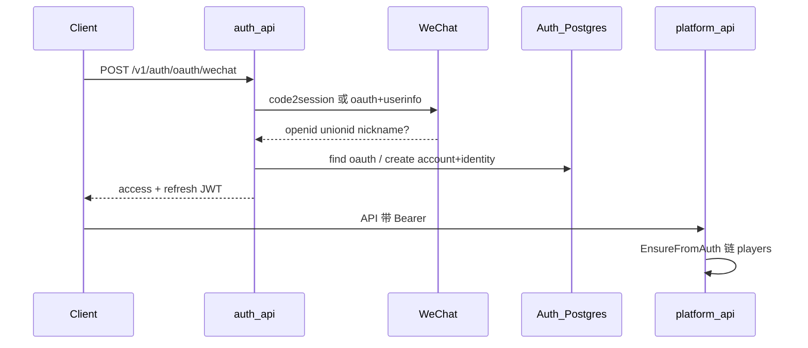

# OAuth（第三方登录）

> 实现位于 [auth-service](../../auth-service/)。契约：[auth-service/openapi](../../auth-service/openapi/)。  
> 总览：[auth-service.md](auth-service.md)。Phone/Nickname 归属见该文档「Phone / Nickname 归属」。

## 范围

| 已支持 | 未支持 |
| :--- | :--- |
| 微信 Web（`platform=web`） | QQ / Apple 等（客户端占位，服务端未实现） |
| 微信小程序（`platform=miniprogram`） | 微信手机号快速验证组件（需另接） |
| `WECHAT_MODE=mock` 本地假 openid | 运营后台改 OAuth 绑定 |

API：`POST /v1/auth/oauth/wechat` → `{ platform, code }`。

## 涉及的表

### Auth 库（`auth-service` 迁移，`auth_schema_migrations`）

| 表 | 作用 | OAuth 相关列 |
| :--- | :--- | :--- |
| **`auth_accounts`** | 账号主表 | 新建时写入种子 `nickname`、`avatar_url`；`phone`/`email` 可为空（纯微信号） |
| **`auth_oauth_identities`** | 第三方身份绑定 | `account_id`, `provider`, `platform`, `open_id`, `union_id` |
| **`auth_refresh_tokens`** | Refresh 会话 | 登录成功后与其它入口一样发双 Token（非 OAuth 专属结构） |

`auth_oauth_identities` 约束要点：

- `UNIQUE (provider, platform, open_id)`
- 按 `union_id` 可跨 web/小程序找同一账号（有索引，允许 NULL）

迁移：`auth-service/migrations/000001_auth*.sql`、`000002_identity*.sql`、`000003_refresh_grace*.sql`。

### 游戏库（`server` 迁移，`schema_migrations`）

| 表 | 作用 | 与 OAuth 的关系 |
| :--- | :--- | :--- |
| **`players`** | 游戏玩家 | **无** OAuth 明细列；仅 `auth_account_id` 软链 + phone 缓存 + **大厅花名** `nickname` |
| **`admin_users`** | 运营账号 | 同上软链；**管理员不走微信自动建号** |

游戏库**禁止**出现 `auth_oauth_*` 表或跨库 JOIN。进房/HTTP 鉴权时用 JWT `AccountID` → `EnsureFromAuth` 建/链 `players`。

## 第三方字段落点

| 微信侧数据 | 落库 | 说明 |
| :--- | :--- | :--- |
| openid | `auth_oauth_identities.open_id` | 按 platform 区分 |
| unionid | `auth_oauth_identities.union_id` | 优先用 union 找号 |
| 昵称 | **仅新建** → `auth_accounts.nickname` | 种子；不覆盖老号；大厅花名在 `players.nickname` |
| 头像 | **仅新建** → `auth_accounts.avatar_url` | Web userinfo；小程序 jscode2session 无昵称/头像 |
| 手机号 | 通常不落 | 默认 OAuth 无手机号；需用户手机号登录/另绑 |

查找顺序：`union_id` → `(provider, platform, open_id)` → 无则 `CreateAccount` + `CreateOAuthIdentity`。

## 数据流

## 环境变量

| 变量 | 说明 |
| :--- | :--- |
| `WECHAT_MODE` | `mock` \| `live` |
| `WECHAT_MP_APP_ID` / `WECHAT_MP_SECRET` | 小程序 |
| `WECHAT_WEB_APP_ID` / `WECHAT_WEB_SECRET` | 网站应用 |

见 `auth-service/.env.example`。

## AI / 人工修改约束（摘要）

完整规则见仓库 [`.cursor/rules/oauth.mdc`](../../.cursor/rules/oauth.mdc)。要点：

1. OAuth 身份与密钥逻辑只改 `auth-service`；**不要**在 `server/` 建 OAuth 表或 JOIN `auth_oauth_*`。
2. 已存在账号再次登录：**禁止**用第三方昵称/头像覆盖 `auth_accounts` 或 `players.nickname`。
3. 新增 provider：新迁移扩展 `auth_oauth_identities`（或等价）+ OpenAPI + 解析器；同步更新本文与 rule。
4. 改绑/解绑、手机号合并需显式产品设计与迁移，禁止静默改 `open_id` 主键语义。
5. 生产密钥不入仓；mock 模式不得用于生产。
